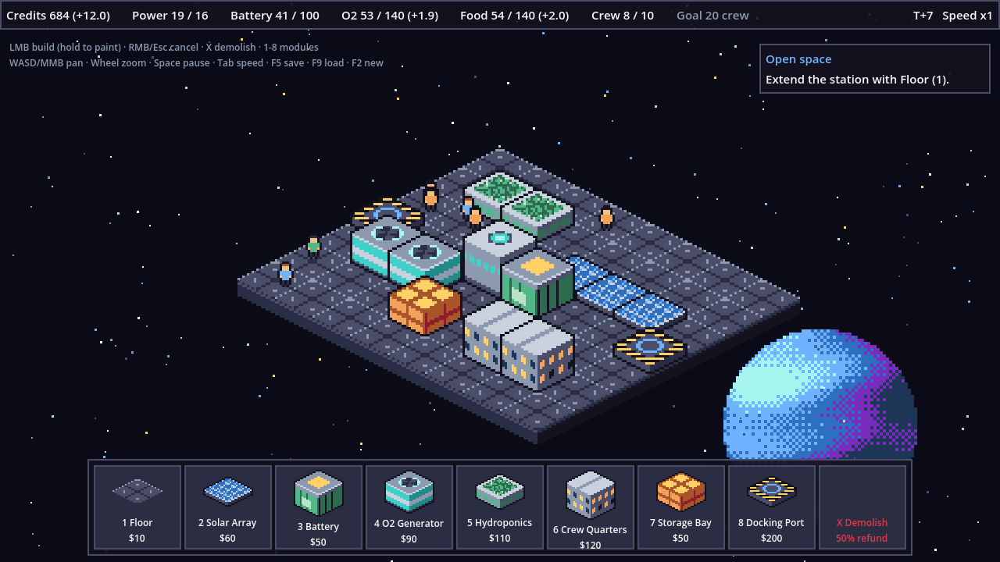

# G1 — Space Station Builder (prototype)

Isometric 2D retro pixel-art space station builder / strategy game, built with
Godot 4.2. This is the **Phase 0 systems prototype**: placeholder art, the full core
loop (build → power → life support → crew → credits → build).



## Run it

```bash
/Applications/Godot.app/Contents/MacOS/Godot --path game
```

Or open `game/project.godot` in the Godot editor and press F5.
Add `-- --demo` to start with a pre-built station:

```bash
/Applications/Godot.app/Contents/MacOS/Godot --path game -- --demo
```

**Controls:** 1–8 pick a module · LMB build (hold to paint) · X demolish · RMB/Esc
cancel · WASD/arrows/MMB pan · wheel zoom · Space pause · Tab speed · F5/F9
save/load · F2 new game.

## Layout

```
docs/            design doc, roadmap, art pipeline spec
tools/           gen_placeholders.py — regenerates programmer art + palette
art/palette/     station.gpl / station.hex (load into Aseprite)
art/source/      .aseprite source files go here (not imported by Godot)
game/            the Godot project
  data/buildings.json        all module stats (tune here)
  scenes/main.tscn           single scene; most UI is built in code
  scripts/autoload/          Controls (input map), BuildingDB, GameState (model + sim)
  scripts/core/iso.gd        2:1 iso grid math
  scripts/station/           StationView (rendering), BuildController (input → build)
  scripts/camera, ui, fx, crew
  tests/sim_smoke_test.gd    headless simulation test
```

Architecture: `GameState` owns all saveable state and the 1 Hz simulation tick;
views only listen to its signals (`cell_changed`, `resources_changed`, …). This
keeps save/load trivial and lets the sim be tested headless.

## Test

```bash
/Applications/Godot.app/Contents/MacOS/Godot --headless --path game -s res://tests/sim_smoke_test.gd
```

## Art

Regenerate placeholders with `python3 tools/gen_placeholders.py` (needs Pillow).
To replace them with Aseprite or Retro Diffusion art, follow
[docs/ART_PIPELINE.md](docs/ART_PIPELINE.md). Keep the filenames, sizes and anchors
the same, and no code changes are needed.

## Docs

- [Game design](docs/GAME_DESIGN.md): pillars, core loop, systems, buildings, open questions
- [Roadmap](docs/ROADMAP.md): phases 0–5 with checklists and tech decisions
- [Art pipeline](docs/ART_PIPELINE.md): sprite specs, palette, Aseprite and Retro Diffusion workflow
